# ESP32-S3/-S31/-P4-MiniWebRadio V4

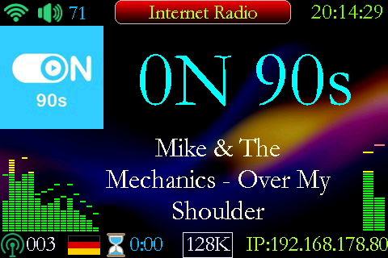

MiniWebRadio Features:
<ul>
<li>User interfaces: TFT touchscreen display, web browser and FTP</li>
<li>Functions: WiFi Radio, Digital Clock, MP3 player, Alarm, Sleep timer, adjust screen brightness, EQ settings and Volume, web browser User Interface, access SD card via FTP (e.g. FileZilla), IR remote controller support</li>
<li>Up to 999 pre-set stations can be held in stations.csv file on SD card (can edit using web UI)</li>
<li>Each station can display its own station icon (when saved to SD card)</li>
<li>Time is obtained via Network Time Protocol (NTP) from internet. Local Time Zone can be set from web UI</li>
<li>Web UI - MiniWebRadio can be accessed via any web browser (e.g. IE/Edge/Chrome/FireFox)</li>
<li>Internal SD card can be accessed via FTP (e.g. FileZilla)</li>
<li>Your home WiFi router SSID and password can be set using the browser on your smart phone (only required on first boot) or edit the networks.csv file on SD card</li>
<li>Play audio files on SD card or on DLNA home network (via web UI)</li>
<li>Use Infra-Red (IR) remote controller (38kHz NEC-encoded - e.g. arduino or mp3 remote). The web UI allows you to configure the buttons if required</li>
<li>One Alarm time can be pre-set using display (choose days, Monday-Sunday)</li>
<li>A Sleep timer can be set using display (switches off sound and screen after a pre-set time - max. 6 hours)</li>
<li>Can announce the time each hour when in radio mode (set via web UI)</li>
<li>Screen brightness can be adjusted using display (if the display has a backlight-pin)</li>
<li>Supports the Latin, Greek and Cyrillic character sets</li>
<li><a href="https://www.radio-browser.info/">Community Radio Browser</a> is integrated as a search engine. User can find new stations and then add them to the station list via web UI (with station icon if available) and then save the list and station icon file to the SD card</li>
<li>Channel lists can be exported or imported in Excel format (for data backup).</li>
</ul> 
Required HW:
<ul>
<li>ESP32-S3, -S31 or -P4 board with <b>8MB of flash</b> or more, and at least <b>8MB of PSRAM</b></li>
<li>At least <b>16MB</b> of flash is required for OTA, <b>8MB</b> without OTA  </li>
<li>DAC (e.g. PCM5102a, PCM5122 etc.)</li>
<li>SPI Display with Display controller ILI9341 (320x240px), ILI9486 (480x320px), ILI9488 (480x320px) or ST7796 (480x320px) with TP Controller XPT2046 or FT6x36  </li>
<li>RGB Display (800x480) </li>
<li>DSI Display with Display controller ST7701 (800x480), EK97007(1024x600) or JD9165 (1024x600) with Touchpad GT911 </li>
<li>SD Card (FAT32) + SD card adapter </li>

<li>SD Card</li>
The SD card was always operated in SD_MMC mode. Both 1-wire and 4-wire operation are possible.
In 1-wire mode, D1, D2 and D3 are set to -1.

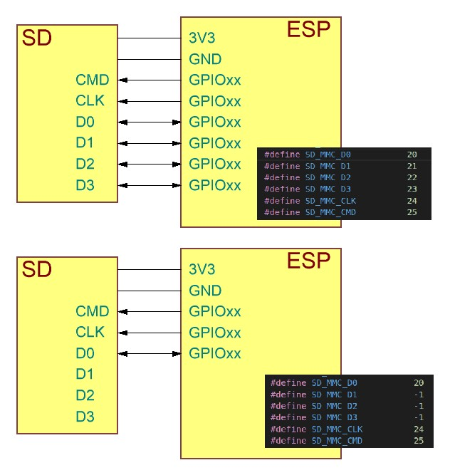 

<li>Display</li>
Only the resolutions listed here are supported. Displays with other resolutions (including square and round displays) cannot be used!

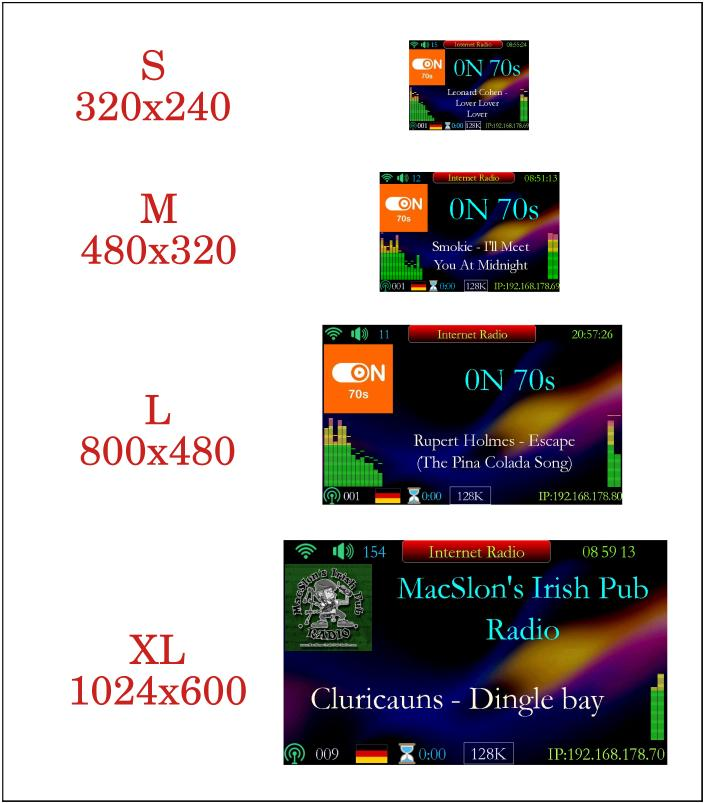 

SPI displays (320x240 or 480x320) with the Tp controllers XPT2046 or FT6x36 are suitable.
However, the SD card adaptors fitted to SPI displays are often connected to MISO/MOSI/SCK and cannot be used as SD_MMC!

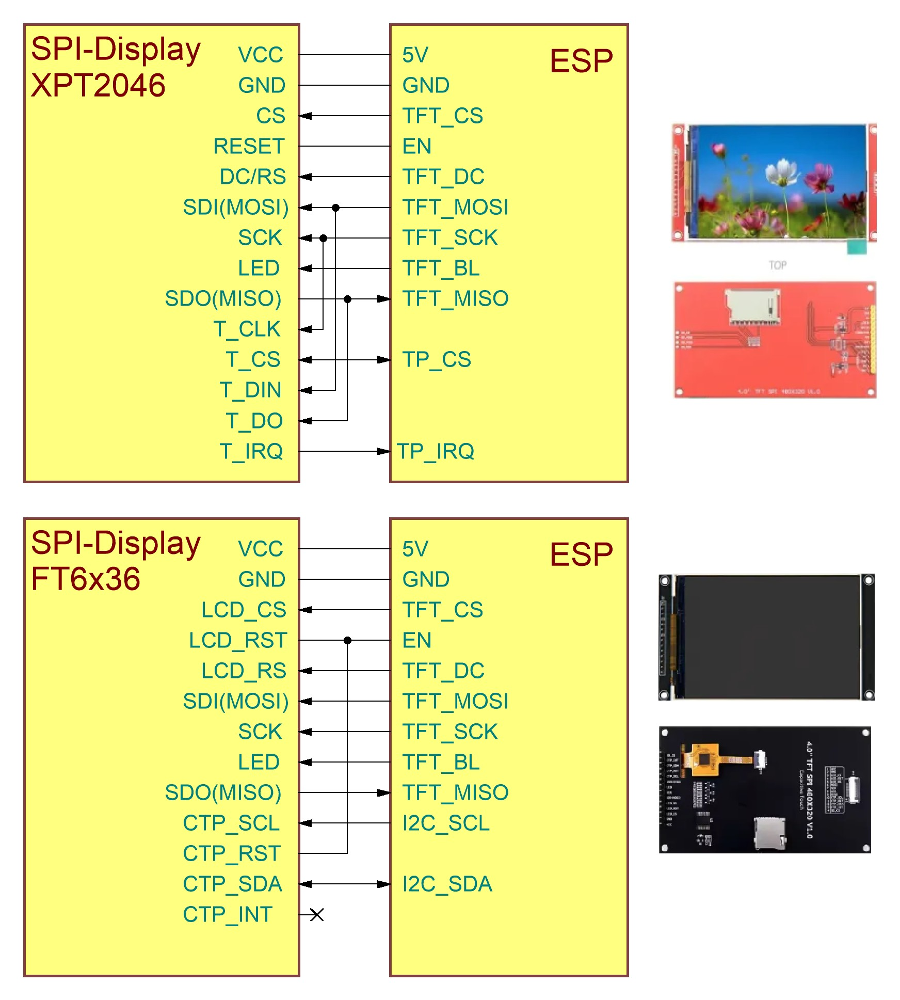 

Boards with an integrated display are almost always suitable. Important: 4MB of flash memory is not enough!
With RGB displays using the ESP32-S3, a fair bit of tinkering is required to make the GPIOs available for the DAC and the IR remote control.

<li>Tested Displays</li>

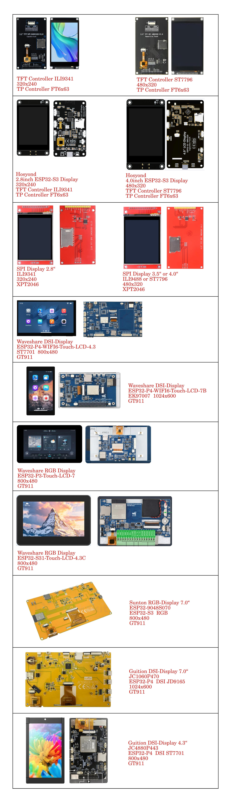 

<li>DAC</li>
If there is an ES8311 on the board, it will be detected via I2C and initialised during setup.
It is better to use an external DAC

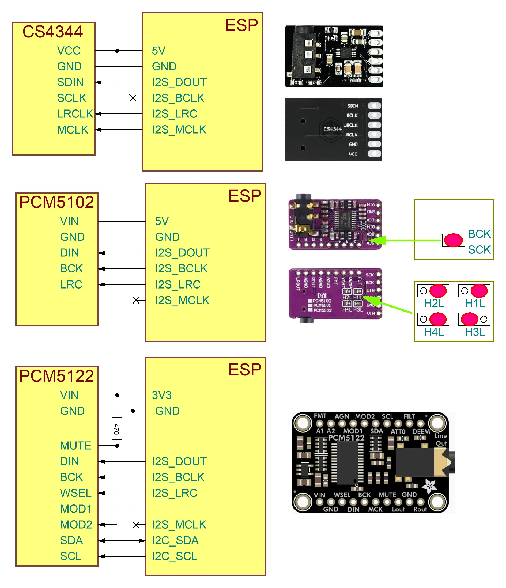 

</ul>
Optional HW:
<ul>

<li>Ethernet</li>
If the board has an Ethernet port, this can be used. It is important to distinguish between RGMII and RMII. If the pins are configured correctly, the controller will be initialised automatically. If the Ethernet controller is assigned an IP address during setup, Wi-Fi will be ignored.

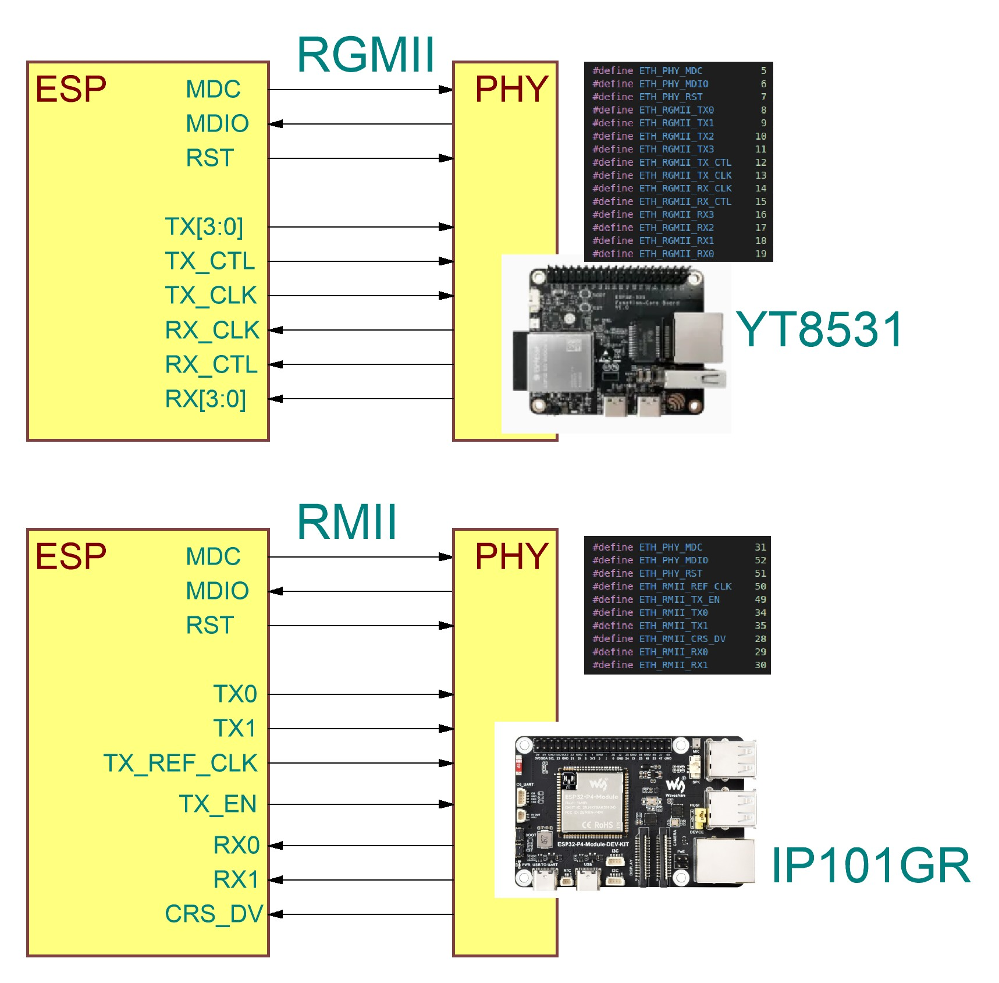 

<li>IR receiver</li>
Various 38KHz IR receivers can be used. While the TSOP4838 can be used without any problems, the VS1838B is very sensitive to high frequency fields despite its metal shielding. The VS1838B should not be installed near the WiFi antenna. The HS0038A2D is also suitable. HS0038 - HS0038A2 can be used with Vcc 5V.

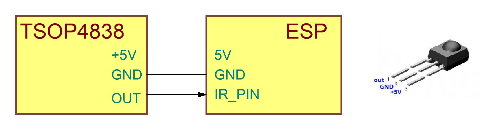 

<li>IR remote controller</li>
The remote control must support the NEC protocol. If several remote controls are operated in one room, they must have different address codes to avoid mutual interference. The "Android X96" remote control is well suited for this purpose.

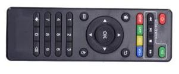 

<li>Bluetooth</li>
Whilst the internal Bluetooth hardware is initialised automatically on the ESP32-S31, the ESP32-S3 and ESP32-P4
require external hardware for Bluetooth. 
KCX_BT_EMITTER V1.7: for connecting external Bluetooth devices, needs sufficient free GPIOs.

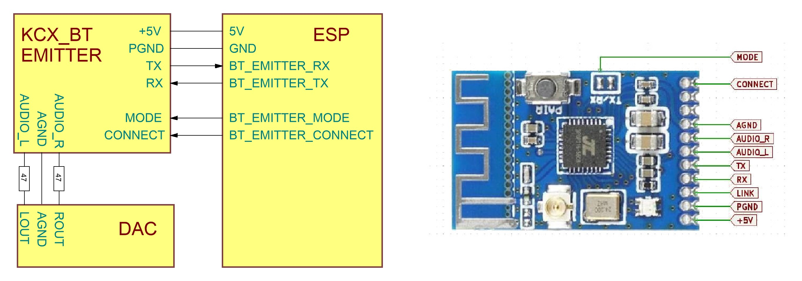 

<li>BH1750 light sensor</li>
The BH1750 has a wide range of values, which is still sufficiently sensitive at average room brightness. On the display, you can set the desired brightness when the sensor is darkened. Then the display is dimmed to this value 'at night', needs sufficient free GPIOs.

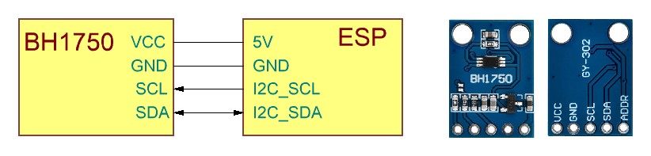 

</ul> 

Control is via the display touchscreen or a web page in a browser, no additional components such as switches, rotary encoders, capacitors or resistors are required.

[Display Layout](docs/MiniWebRadio%20V3.4%20Layout.pdf) 

[Using the Community Radio Browser](docs/Using%20the%20RadioBrowser.pdf) 

[How to install](docs/How%20to%20install.pdf) : PlatformIO is definitely recommended as the IDE.

#### Some features:

- The audioprocess works in its own task and is decoupled. This prevents dropouts when drawing on the display or when the website is loading.
- Audio can be decoded using software. Possible formats are mp3, aac, mp4, opus, vorbis and flac.
- External DACs (e.g. UDA13348, MAX98357A, PCM5102A) are connected via I2S, ES8388 and PCM5122 also require an I2C connection
- The SD card files can be accessed via FTP. See settings for [Filezilla](docs/Filezilla.pdf). The username and password are 'esp32' (this can be changed in 'common.h')
- Can process local playlists in m3u format
- IR remote button codes can be changed by user using web UI
- Improved web UI reliability
- VU meter ans spectrum added to display
- Timezone can be set using web UI
- Play media files on home network DLNA (uPNP/DLNA app on smart phone, router, etc.)
- Prevent clicks when changing radio stations

 

|Codec       |                                                       |
|------------|-------------------------------------------------------|
| mp3        | y                                                     |
| aac        | y                                                     |
| aacp       | y (+SBR, +PS)                                         |
| wav        | y                                                     |
| flac       | y (blocksize max 16KB)                                |
| vorbis     | y <=256Kbit/s                                         |
| opus       | y (except hybrid mode)                                |

***
 

[self-made devices of the users](https://github.com/schreibfaul1/ESP32-MiniWebRadio/wiki/User-devices) 

***

 
___________________________________________________________
 

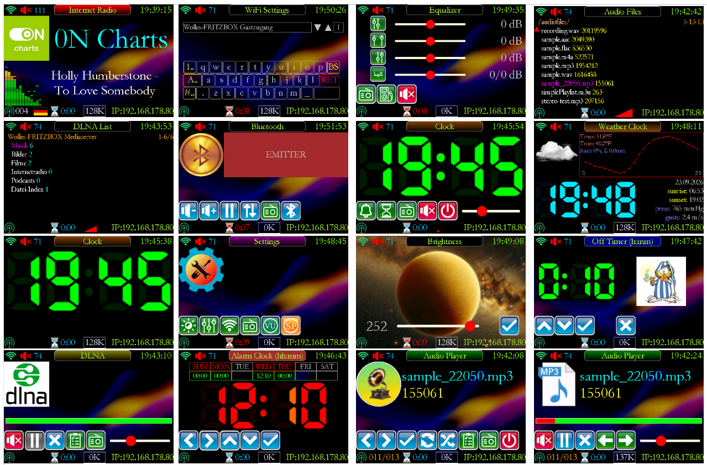 
 

